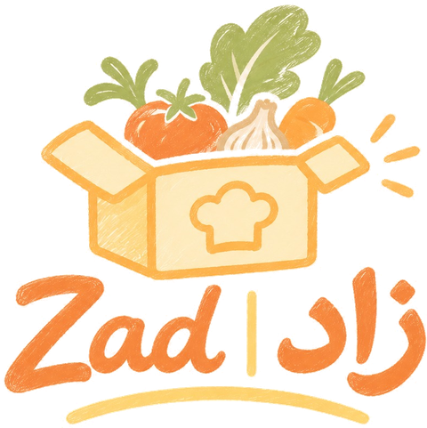

<div align="center">
  
</div>

<h1 align="center">Zad | زاد</h1>

<p align="center"><strong>Fresh ingredients. Your touch. Your meal.</strong><br>
<span dir="rtl">مكونات طازجة. لمستك. وجبتك.</span></p>

<p align="center">
  <a href="https://ashldny.github.io/zad/">Live site</a> ·
  <a href="https://ashldny.github.io/zad/?checkout">Checkout preview</a>
</p>

---

## About this project

This repository holds the **landing page and clickable prototype** for Zad, our group's business idea for **CMPS307: Introduction to Project Management** (Fall 2026).

The course project takes one business idea from first concept to a pitch. This website covers two of the deliverables:

- **Landing page and analytics.** A marketing page that explains the idea and records the actions we would measure.
- **Prototype.** A clickable version of the customer journey: browse recipes, customize a kit, build a box, and check out.

The other deliverables are kept outside this repo: the idea brief and value proposition, multi-criteria idea voting, SWOT analysis, Business Model Canvas, market feasibility study, funding and support study, growth study, customer-insight and MVP-testing mind maps, project schedule (PERT), and a two-minute pitch video.

> This is a student prototype. Menus, prices, delivery areas and order flows are illustrative. No real orders are taken and no data leaves the browser.

## The business idea

**Zad** (زاد, Arabic for *provisions*, the food you carry for a journey) is a meal-kit service in Qatar. Each box holds fresh, pre-portioned ingredients and an easy-to-follow recipe for an authentic Qatari or Arab home-cooked dish.

- **The idea:** make it easy and enjoyable to cook traditional dishes at home with fresh, high-quality ingredients, while still adding your own touch.
- **The goal:** bring the flavours of Qatari and Arab home cooking to more homes by combining tradition, freshness and convenience in one box.

### The problem

- **No time to plan.** Busy households spend hours each week deciding what to cook, shopping and prepping.
- **Food gets wasted.** Buying a whole bunch or bag for one recipe leaves half of it unused.
- **Shopping is slow.** Traditional dishes need ingredients from several shops, and standard meal kits rarely cover local cuisine or let you customize it.

### How Zad works

1. **Pick your recipes** in the Zad app or on the website.
2. **Make it yours.** Choose servings, swap the protein and set the spice level. Quantities adjust automatically.
3. **We pack and deliver** the ingredients, weighed and chilled, with a printed recipe card.
4. **Cook and enjoy.** Follow the card, or scan its QR code for a short video tutorial.

### Plans shown on the site (illustrative)

| Plan | What's included | Price |
|---|---|---|
| Solo | 2 recipes for 1 person | QAR 165 / week |
| Family | 3 recipes for 4 people | QAR 310 / week |
| Chef Plus | 4 recipes with premium ingredients, chef and seasonal boxes | QAR 440 / week |

## The website

### What's on the page

- **Hero:** the brand tagline in English and Arabic, with a carousel (click to pause) showing the annotated Zad box, what's in every box, and who Zad is for
- **How it works:** four illustrated steps
- **This week's menu:** six Qatari dishes with filters, cooking times and spice levels
- **Add your own touch:** a recipe card that updates live as you change the protein, servings, spice and add-ons
- **Plans, ordering channels, FAQ** and a founding-families waitlist
- **Box and checkout:** the cart merges repeat items into one line with +/− quantity controls and dish thumbnails. Checkout covers the delivery address, delivery day and time, payment method, an order summary, and an order confirmation with a delivery tracker.

### Run it locally

No build step: it's plain HTML, CSS and JavaScript.

```bash
python -m http.server 8000
```

Then open http://localhost:8000.

### Files

```
index.html        page markup
styles.css        all styles (brand colours and type are defined at the top)
script.js         menu, customizer, cart, checkout and carousel
assets/           logo, wordmark, box illustrations and favicon
```

## Team

CMPS307 group project, Fall 2026.

<!-- Add team member names and roles here -->
